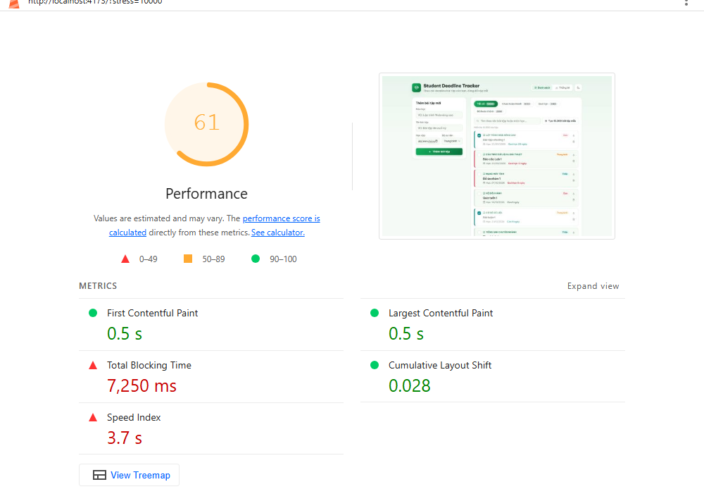
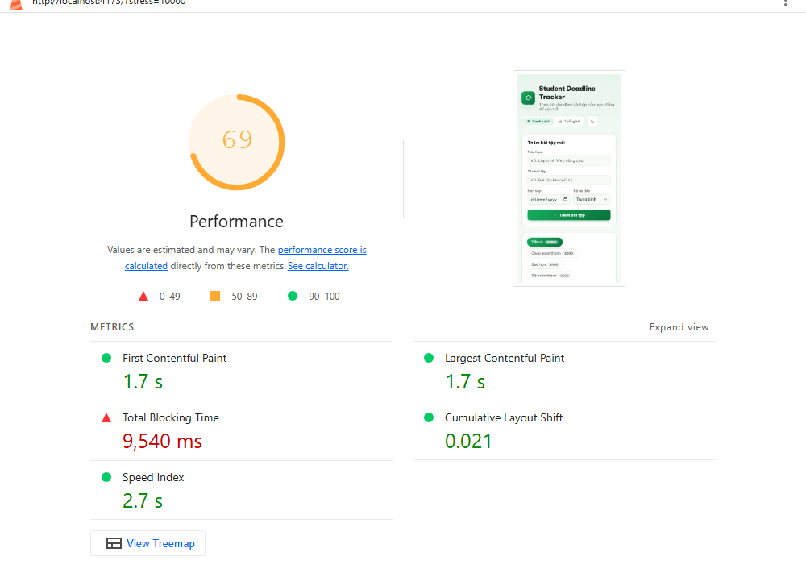
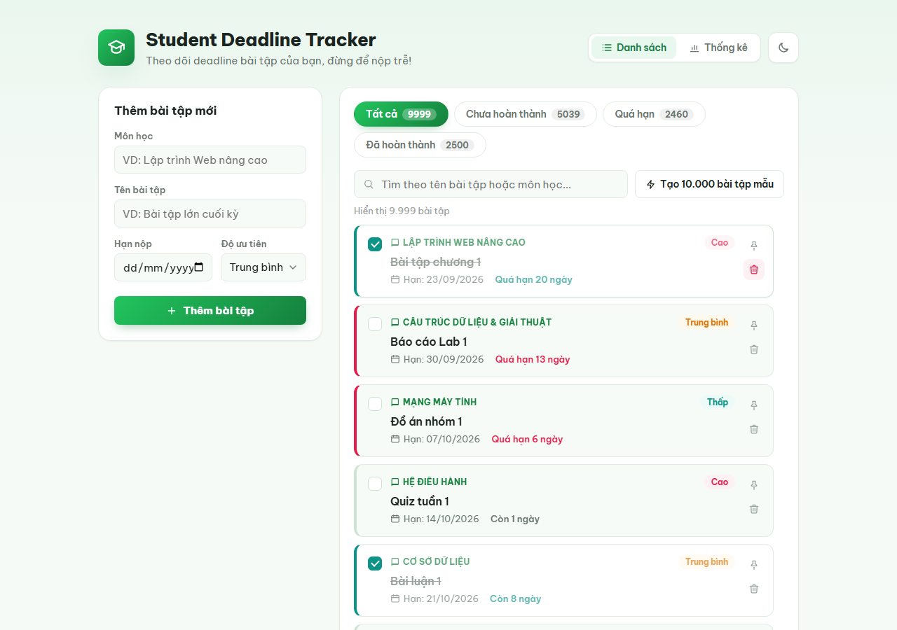
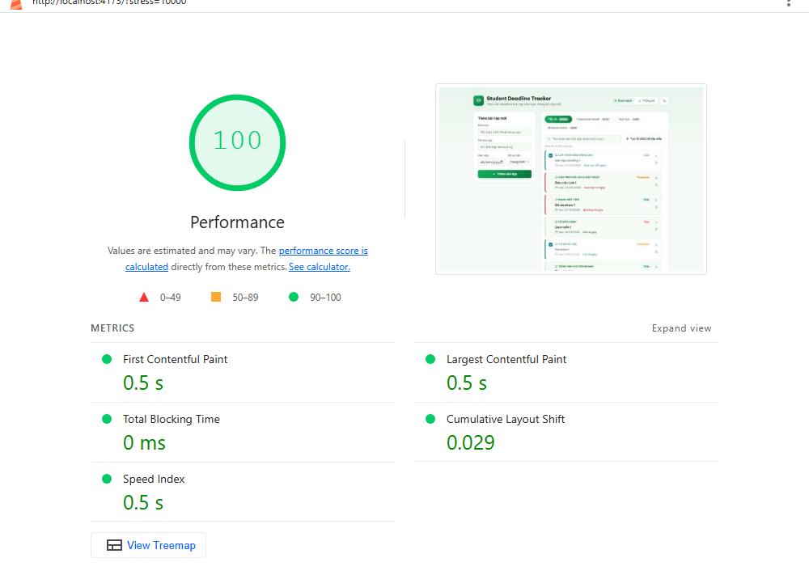
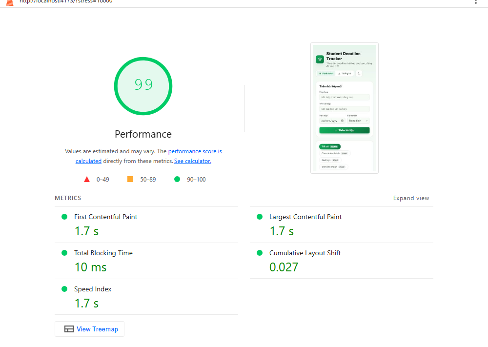

# Phần B: Tối ưu hiệu năng (Student Deadline Tracker)

Báo cáo đo hiệu năng trang danh sách với **10.000 bài tập**, trước và sau khi áp dụng 4 kỹ thuật tối ưu.

## 1. Kết quả tóm tắt

| Chỉ số | Trước | Sau | Thay đổi |
|---|---:|---:|---:|
| Số lần render `AssignmentCard` khi gõ "Lab 5" vào ô tìm kiếm | **10.945** | **9** | giảm ~1.200 lần |
| Số lần render `AssignmentCard` khi tạo 10.000 bài | 10.000 | 9 | giảm ~1.100 lần |
| Lighthouse Performance (desktop) | **61** | **100** | +39 điểm |
| Lighthouse Performance (mobile) | **69** | **99** | +30 điểm |
| Thời gian render 10.000 bài (bản production) | 2.732 ms | 28 ms | nhanh hơn ~98 lần |
| Độ trễ phím chậm nhất khi tìm kiếm (bản production) | 616 ms | 32 ms | nhanh hơn ~19 lần |
| Số DOM node sau khi tạo 10.000 bài | 270.082 | 335 | giảm ~800 lần |

## 2. Chế độ stress test

- Nút **"Tạo 10.000 bài tập mẫu"** ([StressTestButton.tsx](src/components/StressTestButton.tsx)) gọi `generateMockAssignments(10_000)` ([mockData.ts](src/features/assignments/mockData.ts)) rồi `dispatch(replaceAll(...))` để thay toàn bộ danh sách.
- Dữ liệu sinh ra **tất định**: cùng số lượng thì luôn ra cùng một dữ liệu. Nhờ vậy lần đo trước và sau dùng đúng một bộ dữ liệu.
- Lighthouse không bấm được nút, nên trang hỗ trợ thêm tham số URL `?stress=10000` để tự nạp 10.000 bài ngay khi mở trang ([App.tsx](src/App.tsx)).

## 3. Cách đo

| Hạng mục | Công cụ | Bản build | Ghi chú |
|---|---|---|---|
| Số lần render | Script Playwright dùng hook `__REACT_DEVTOOLS_GLOBAL_HOOK__`, cùng nguồn dữ liệu với **React DevTools Profiler** | Dev (`npm run dev`) | Đếm theo quy tắc của Profiler: component mới mount hoặc thực sự render lại trong commit đó |
| Điểm Performance | **Lighthouse 13.5.0**, chỉ chạy hạng mục Performance | Production (`vite build` + `vite preview`) | URL `/?stress=10000`. Có cả preset desktop và mobile (mobile giả lập CPU chậm 4 lần và mạng 4G chậm) |
| Thời gian render, độ trễ phím | Playwright + Event Timing API (API mà chỉ số INP dùng) | Production | Lấy trung vị của 3 lần chạy |

Kịch bản đo:
1. Mở trang danh sách, chờ dữ liệu ban đầu tải xong.
2. Bấm "Tạo 10.000 bài tập mẫu".
3. Gõ lần lượt **"Lab 5"** (5 phím, mỗi phím cách nhau 120 ms, giống tốc độ gõ thật) vào ô tìm kiếm. Kết quả cả hai bản đều là "Hiển thị 111 bài tập".

Môi trường: Windows 11, Node 22.22.1, Chromium headless (Playwright 1.63.0), React 19.3.0, react-window 2.3.4.

## 4. Đo trước khi tối ưu

Bản "trước" đã có đủ chức năng (nút stress test, ô tìm kiếm, ghim, trang Thống kê) nhưng chưa áp dụng kỹ thuật tối ưu nào.

**Profiler: số lần render**

| Thao tác | Lần render `AssignmentCard` | Số commit | Thời gian (bản dev) |
|---|---:|---:|---:|
| Tạo 10.000 bài | 10.000 | – | 3.935 ms |
| Gõ "Lab 5" (5 phím) | **10.945** | 5 | 3.409 ms * |

\* Thời gian tính từ phím đầu tiên tới khi giao diện xong. Riêng khoảng cách giữa các phím đã chiếm khoảng 600 ms.

Nguyên nhân:
- Mỗi phím lọc lại ngay cả 10.000 phần tử.
- Mọi thẻ khớp kết quả đều được render lại. Phím đầu "L" còn rất nhiều kết quả, các phím sau thu hẹp dần, cộng lại là 10.945 lần render.
- Toàn bộ 10.000 thẻ được gắn vào DOM, tức 270.082 node.

**Lighthouse**

| Preset | Điểm | FCP | LCP | TBT | Speed Index | CLS |
|---|---:|---:|---:|---:|---:|---:|
| Desktop | **61** | 0,5 s | 0,5 s | 7.250 ms | 3,7 s | 0,028 |
| Mobile | **69** | 1,7 s | 1,7 s | 9.540 ms | 2,7 s | 0,021 |

Điểm bị kéo xuống chủ yếu bởi **Total Blocking Time** (7–9,5 giây). Luồng chính bị khoá trong lúc React tạo 10.000 thẻ.

| Lighthouse desktop, trước khi tối ưu | Lighthouse mobile, trước khi tối ưu |
|---|---|
|  |  |

## 5. Các kỹ thuật đã áp dụng

### 5.1. `React.memo` cho `AssignmentCard` + `useCallback` cho handler

- [AssignmentCard.tsx:18](src/components/AssignmentCard.tsx#L18): bọc component bằng `memo`.
- [AssignmentList.tsx:66-67](src/components/AssignmentList.tsx#L66-L67): `handleToggleComplete` và `handleDelete` bọc `useCallback`. `togglePin` lấy từ Zustand, vốn đã có tham chiếu cố định.
- Redux Toolkit (Immer) giữ nguyên tham chiếu của các bài tập không đổi. Vì vậy khi đánh dấu hoàn thành hay ghim một bài, chỉ thẻ của bài đó render lại.
- Có test kiểm chứng điều này trong [assignmentsSlice.test.ts](src/features/assignments/__tests__/assignmentsSlice.test.ts).

### 5.2. `useDebounce` (300 ms) cho ô tìm kiếm + `useMemo` cho phần lọc

- [useDebounce.ts](src/hooks/useDebounce.ts): hook tự viết, chỉ trả về giá trị mới khi người dùng ngừng gõ đủ 300 ms.
- [AssignmentList.tsx:51](src/components/AssignmentList.tsx#L51): ô input vẫn cập nhật ngay theo từng phím, nhưng việc lọc dùng `debouncedQuery`.
- [AssignmentList.tsx:56](src/components/AssignmentList.tsx#L56): phần lọc 10.000 phần tử và sắp xếp bài đã ghim lên đầu nằm trong `useMemo`. Nó chỉ chạy lại khi từ khoá đã debounce, danh sách hoặc danh sách ghim thay đổi.
- Kết quả: gõ 5 phím chỉ lọc **1 lần** thay vì 5 lần.

### 5.3. Virtualization bằng `react-window`

- [AssignmentList.tsx:119](src/components/AssignmentList.tsx#L119): dùng `<List>` với `rowHeight = 114` (chiều cao thẻ 104 px cộng khoảng cách 10 px).
- Chỉ render các dòng nằm trong khung nhìn (cao tối đa 680 px) cộng vài dòng đệm, khoảng **9–12 thẻ** thay vì 10.000.
- `rowProps` được `useMemo` để `List` không render lại các dòng khi không cần.



### 5.4. `React.lazy` + `Suspense` cho trang Thống kê

- [App.tsx:13](src/App.tsx#L13): `const StatsPage = lazy(() => import('./components/StatsPage'))`.
- [App.tsx:81](src/App.tsx#L81): bọc trong `<Suspense>`, có spinner "Đang tải trang thống kê...".
- Trang Thống kê ([StatsPage.tsx](src/components/StatsPage.tsx)) đếm số bài đã xong, chưa xong, quá hạn và thống kê theo từng môn ([stats.ts](src/features/assignments/stats.ts)).
- Khi build, trang này được tách thành chunk riêng `StatsPage-*.js` (2,61 kB, gzip 0,95 kB) và chỉ tải khi người dùng bấm "Thống kê".

### 5.5. Dùng đúng chỗ, không lạm dụng

| Kỹ thuật | Dùng ở | Không dùng ở | Lý do |
|---|---|---|---|
| `React.memo` | `AssignmentCard` | `SearchBox`, `FilterTabs`, `AssignmentForm`, … | Chỉ thẻ bài tập bị render hàng nghìn lần. Các component khác chỉ có 1 instance và render rẻ, so sánh props còn tốn hơn |
| `useCallback` | Handler truyền xuống thẻ đã `memo` | Handler nội bộ (`onSubmit` của form, …) | `useCallback` chỉ có ích khi component con so sánh props |
| `useMemo` | Lọc 10.000 phần tử, `Set` ghim, `rowProps` | Các phép tính nhỏ | Chỉ memo phép tính tốn kém hoặc giá trị cần giữ tham chiếu |
| Debounce | Ô tìm kiếm | Các ô của form thêm bài | Form chỉ cập nhật state cục bộ, không kích hoạt lọc danh sách |
| Lazy load | Trang Thống kê | Trang Danh sách | Danh sách là màn hình đầu tiên, tải lazy chỉ làm chậm lần hiển thị đầu |

## 6. Đo sau khi tối ưu

**Profiler: số lần render**

| Thao tác | Lần render `AssignmentCard` | Số commit | Thời gian (bản dev) |
|---|---:|---:|---:|
| Tạo 10.000 bài | 9 | – | 52 ms |
| Gõ "Lab 5" (5 phím) | **9** | 7 | 698 ms * |

\* Gần như toàn bộ là khoảng cách giữa các phím (~600 ms) cộng thời gian chờ debounce. Giao diện không còn bị khoá.

Cả 7 commit cộng lại chỉ có 9 lần render `AssignmentCard`, đúng bằng số thẻ hiện trên màn hình. Nghĩa là danh sách chỉ được lọc và vẽ lại **1 lần**, sau khi người dùng ngừng gõ đủ 300 ms. Các commit còn lại chỉ cập nhật ô input.

**Lighthouse**

| Preset | Điểm | FCP | LCP | TBT | Speed Index | CLS |
|---|---:|---:|---:|---:|---:|---:|
| Desktop | **100** | 0,5 s | 0,5 s | 0 ms | 0,5 s | 0,029 |
| Mobile | **99** | 1,7 s | 1,7 s | 10 ms | 1,7 s | 0,027 |

| Lighthouse desktop, sau khi tối ưu | Lighthouse mobile, sau khi tối ưu |
|---|---|
|  |  |

## 7. Bảng so sánh trước / sau

| Chỉ số | Trước | Sau |
|---|---:|---:|
| **Render `AssignmentCard` khi gõ tìm kiếm (5 phím)** | 10.945 | 9 |
| Render `AssignmentCard` khi tạo 10.000 bài | 10.000 | 9 |
| Số lần lọc danh sách khi gõ 5 phím | 5 | 1 |
| **Lighthouse Performance, desktop** | 61 | 100 |
| **Lighthouse Performance, mobile** | 69 | 99 |
| Total Blocking Time, desktop | 7.250 ms | 0 ms |
| Total Blocking Time, mobile | 9.540 ms | 10 ms |
| Speed Index, desktop | 3,7 s | 0,5 s |
| Speed Index, mobile | 2,7 s | 1,7 s |
| FCP / LCP, desktop | 0,5 s / 0,5 s | 0,5 s / 0,5 s |
| FCP / LCP, mobile | 1,7 s / 1,7 s | 1,7 s / 1,7 s |
| Thời gian render 10.000 bài (production, trung vị 3 lần) | 2.732 ms | 28 ms |
| Độ trễ phím chậm nhất (production) | 616 ms | 32 ms |
| Độ trễ phím trung bình (production) | 240 ms | 28 ms |
| Số DOM node với 10.000 bài | 270.082 | 335 |
| Trang Thống kê | Nằm trong bundle chính | Chunk riêng 2,61 kB, tải khi cần |

## 8. Nhận xét

- **Virtualization** đem lại cải thiện lớn nhất. Số thẻ phải tạo và số DOM node giảm từ hàng chục nghìn xuống vài chục, nên TBT gần như về 0.
- **Debounce + `useMemo`** làm việc gõ phím mượt hơn: độ trễ mỗi phím giảm từ 240–616 ms xuống khoảng 30 ms, và chỉ lọc một lần khi người dùng ngừng gõ.
- **`React.memo` + `useCallback`** quan trọng khi thao tác trên từng bài (đánh dấu xong, ghim, xoá): chỉ thẻ thay đổi render lại, các thẻ còn lại được bỏ qua.
- **FCP/LCP không đổi** vì khung trang hiển thị giống nhau ở cả hai bản. 10.000 bài được nạp sau khi trang đã hiện, nên chi phí đó nằm ở TBT và Speed Index, đúng hai chỉ số được cải thiện.
- **Lazy load** trang Thống kê giúp bundle ban đầu nhỏ hơn 2,61 kB. Con số này nhỏ vì trang thống kê đơn giản, còn phần lớn bundle là React/Redux. Lợi ích sẽ rõ hơn khi trang Thống kê lớn dần, ví dụ thêm thư viện biểu đồ.

## 9. Minh chứng và cách tự đo lại

Báo cáo Lighthouse gốc (mở bằng trình duyệt):
- Trước: [desktop](docs/lighthouse/lh-before-desktop.html), [mobile](docs/lighthouse/lh-before-mobile.html)
- Sau: [desktop](docs/lighthouse/lh-after-desktop.html), [mobile](docs/lighthouse/lh-after-mobile.html)

Tự đo lại bằng Chrome DevTools:
1. **Profiler**: `npm run dev` rồi mở trang. Trong React DevTools, mở tab Profiler, bật "Record why each component rendered". Bấm "Tạo 10.000 bài tập mẫu", nhấn Record, gõ "Lab 5" vào ô tìm kiếm rồi dừng. Xem số lần `AssignmentCard` xuất hiện qua các commit.
2. **Lighthouse**: `npm run build && npm run preview` rồi mở `http://localhost:4173/?stress=10000`. Trong Chrome DevTools, mở tab Lighthouse, chọn chỉ mục Performance và chế độ Desktop hoặc Mobile. Nên chạy ở cửa sổ ẩn danh để extension không ảnh hưởng kết quả.

---

# Phần C: Kiểm thử (Jest + React Testing Library)

## 1. Tổng quan

| Hạng mục | Kết quả |
|---|---|
| Số test case | **52**, yêu cầu tối thiểu 12 |
| Số file test | 11 |
| Kết quả | 52/52 pass |
| Coverage toàn dự án | 95,97% statements · 81,04% branches · 94,24% functions · 96,69% lines |
| Coverage `src/features` | 96,22% statements, ngưỡng tối thiểu cấu hình trong Jest là 70% |

Cách chạy:

```bash
npm test                 # chạy toàn bộ test
npm run test:coverage    # chạy kèm báo cáo coverage (HTML ở coverage/index.html)
```

## 2. Công cụ và cấu hình

| File | Vai trò |
|---|---|
| [jest.config.ts](jest.config.ts) | Môi trường `jsdom`. Dùng `ts-jest` để chạy TypeScript, `identity-obj-proxy` để giả lập file CSS. Đặt ngưỡng coverage 70% cho `src/features`. Giới hạn 2 worker để không hết RAM |
| [tsconfig.jest.json](tsconfig.jest.json) | Kế thừa `tsconfig.app.json`, chuyển sang CommonJS cho Jest và thêm kiểu `jest`, `@testing-library/jest-dom` |
| [src/test/setupTests.ts](src/test/setupTests.ts) | Nạp các matcher DOM như `toBeInTheDocument`, `toHaveValue`, `toBeChecked`, … |
| [src/test/renderWithProviders.tsx](src/test/renderWithProviders.tsx) | Render component kèm một Redux store thật, tạo mới cho từng test (không có redux-logger). Cho phép nạp sẵn state qua `preloadedState` |
| [src/test/fixtures.ts](src/test/fixtures.ts) | `makeAssignment()` tạo bài tập mẫu; `daysFromNow(n)` tạo deadline tương đối so với hôm nay |

Để dùng được `renderWithProviders`, store được tách thành [setupStore.ts](src/app/setupStore.ts). Hàm `setupStore()` tạo store mới mỗi lần gọi. Vì vậy các test không dùng chung state, và test không phải import `store.ts` (file này dùng `import.meta.env`, Jest không hiểu).

## 3. Các loại test

| # | Loại test | Kỹ thuật chính | Số test |
|---|---|---|---:|
| 1 | Unit test: hàm thuần, reducer, selector | Gọi hàm trực tiếp, so sánh kết quả | 27 |
| 2 | Custom hook | `renderHook`, `act`, fake timers | 8 |
| 3 | Bất đồng bộ + mock (async thunk) | `jest.mock` thay module API, kiểm tra các trạng thái `pending` / `fulfilled` / `rejected` | 3 |
| 4 | Component và tích hợp (UI) | React Testing Library, `user-event`, Redux store thật | 14 |
| | **Tổng** | | **52** |

### 3.1. Unit test: hàm thuần, reducer, selector (27 test)

**[date.test.ts](src/utils/__tests__/date.test.ts)**: 7 test

| # | Test case |
|---|---|
| 1 | `parseLocalDate` hiểu `yyyy-MM-dd` theo giờ địa phương, không bị lệch ngày |
| 2 | `toIsoDate` thêm số 0 vào tháng/ngày có một chữ số |
| 3 | `calcDaysLeft` tính theo mốc đầu ngày (0, 3, −2 ngày) |
| 4 | `isOverdue` chỉ đúng khi deadline đã qua; hạn hôm nay chưa tính là quá hạn |
| 5–7 | `formatDaysLabel`: "Hạn hôm nay", "Còn 4 ngày", "Quá hạn 3 ngày" (`it.each`) |

**[assignmentsSlice.test.ts](src/features/assignments/__tests__/assignmentsSlice.test.ts)**, phần reducer: 6 test

| # | Test case |
|---|---|
| 8 | `addAssignment` thêm vào đầu danh sách, tự sinh `id`, `completed = false` |
| 9 | `toggleCompleted` đảo trạng thái đúng bài; id không tồn tại thì state không đổi |
| 10 | `toggleCompleted` giữ nguyên tham chiếu các bài khác. Đây là điều kiện để `React.memo` ở Phần B hoạt động |
| 11 | `updateAssignment` gộp các thay đổi vào bài tập |
| 12 | `removeAssignment` xoá theo id |
| 13 | `replaceAll` thay toàn bộ danh sách; `setFilter` đổi bộ lọc |

**[selectors.test.ts](src/features/assignments/__tests__/selectors.test.ts)**: 7 test

| # | Test case |
|---|---|
| 14–17 | `selectVisibleAssignments` lọc đúng theo từng bộ lọc: Tất cả / Đã hoàn thành / Chưa hoàn thành / Quá hạn (`it.each`) |
| 18 | Selector được memo: cùng input trả về cùng một mảng |
| 19 | `selectCounts` đếm đúng số bài trong từng nhóm |
| 20 | `selectCounts` với danh sách rỗng |

**[stats.test.ts](src/features/assignments/__tests__/stats.test.ts)**: 3 test

| # | Test case |
|---|---|
| 21 | `calcStats` đếm số bài đã xong / chưa xong / quá hạn, gom theo môn, môn nhiều bài xếp trước |
| 22 | `calcStats` với danh sách rỗng |
| 23 | `generateMockAssignments(500)` sinh đúng số lượng, id không trùng, cùng đầu vào luôn ra cùng kết quả |

**[pins.test.ts](src/features/pins/__tests__/pins.test.ts)**: 4 test

| # | Test case |
|---|---|
| 24 | `sortPinnedFirst` khi không có ghim: trả về chính mảng cũ, không tạo mảng mới |
| 25 | Bài đã ghim lên đầu, thứ tự tương đối trong mỗi nhóm giữ nguyên |
| 26 | Bỏ qua id ghim không có trong danh sách |
| 27 | Zustand `usePinStore`: `togglePin` ghim rồi bỏ ghim, `isPinned` trả về đúng |

### 3.2. Custom hook (8 test)

**[useDebounce.test.ts](src/hooks/__tests__/useDebounce.test.ts)**: 1 test

| # | Test case |
|---|---|
| 28 | Giá trị chỉ cập nhật sau khi ngừng thay đổi đủ 300 ms; nếu gõ tiếp, bộ đếm bắt đầu lại (dùng fake timers) |

**[useForm.test.ts](src/hooks/__tests__/useForm.test.ts)**: 3 test

| # | Test case |
|---|---|
| 29 | `setField` cập nhật đúng một trường, các trường khác giữ nguyên |
| 30 | `validateAll` trả về `false` và lưu lỗi khi dữ liệu sai, trả về `true` khi hợp lệ |
| 31 | `reset` đưa giá trị về ban đầu và xoá lỗi |

**[useDeadlineCountdown.test.ts](src/hooks/__tests__/useDeadlineCountdown.test.ts)**: 4 test

| # | Test case |
|---|---|
| 32–34 | Deadline còn 3 ngày / hạn hôm nay / quá hạn 2 ngày trả về đúng `daysLeft`, `isOverdue`, `isDueToday`, `label` (`it.each`, cố định thời gian hệ thống) |
| 35 | Tự cập nhật khi qua nửa đêm: "Hạn hôm nay" chuyển thành "Quá hạn 1 ngày" mà không cần component cha render lại |

### 3.3. Bất đồng bộ và mock (3 test)

**[assignmentsSlice.test.ts](src/features/assignments/__tests__/assignmentsSlice.test.ts)**, phần thunk `loadInitialAssignments`. Module API được thay bằng `jest.mock('../api')`.

| # | Test case |
|---|---|
| 36 | API trả dữ liệu: status chuyển `loading` → `succeeded`, `items` là dữ liệu trả về |
| 37 | API lỗi: status `failed`, `error` là thông báo lỗi ("Mất kết nối") |
| 38 | Request bị huỷ (`abort()`, xảy ra khi component unmount hoặc StrictMode chạy effect 2 lần): không bị tính là lỗi |

### 3.4. Component và tích hợp (14 test)

**[AssignmentForm.test.tsx](src/components/__tests__/AssignmentForm.test.tsx)**: 2 test

| # | Test case |
|---|---|
| 39 | Bấm "Thêm bài tập" khi bỏ trống: hiện đủ 3 lỗi validate, store không có bài nào |
| 40 | Nhập đủ thông tin và chọn độ ưu tiên: bài mới vào Redux store, form reset về trạng thái ban đầu |

**[AssignmentList.test.tsx](src/components/__tests__/AssignmentList.test.tsx)**: 9 test

| # | Test case |
|---|---|
| 41 | Đang tải: hiện spinner "Đang tải..." |
| 42 | Tải lỗi: hiện thông báo lỗi (`role="alert"`) |
| 43 | Render danh sách và dòng "Hiển thị 3 bài tập" |
| 44 | Không có bài nào: hiện thông báo trống theo bộ lọc |
| 45 | Tìm kiếm có debounce: chưa lọc trước 300 ms; sau 300 ms lọc theo cả tên bài và môn học, không phân biệt hoa thường |
| 46 | Tìm kiếm không có kết quả: hiện "Không tìm thấy bài tập nào khớp với ..." |
| 47 | Ghim đưa bài lên đầu (`aria-pressed = true`), bấm lần nữa thì bỏ ghim |
| 48 | Đánh dấu hoàn thành và xoá: Redux store và giao diện cập nhật đúng |
| 49 | Virtualization: tạo 10.000 bài nhưng chỉ render dưới 30 thẻ trong DOM |

**[App.test.tsx](src/__tests__/App.test.tsx)**: 3 test tích hợp, render cả App (Redux + ThemeProvider), API được mock

| # | Test case |
|---|---|
| 50 | Tải dữ liệu ban đầu (thấy spinner trước), sau đó bấm tab "Quá hạn" để lọc |
| 51 | Chuyển sang trang Thống kê (`React.lazy`): bảng theo môn tính đúng số liệu, "33% đã hoàn thành"; quay lại trang Danh sách |
| 52 | Đổi theme sáng/tối: thuộc tính `data-theme` trên `<html>` đổi theo và được lưu vào `localStorage` |

## 4. Nguyên tắc viết test

- **Test hành vi, không test chi tiết cài đặt.** Tìm phần tử theo role và nhãn mà người dùng nhìn thấy (`getByRole('button', { name: 'Ghim Lab 5' })`, `getByLabelText('Môn học')`) thay vì theo class CSS. Thao tác bằng `user-event` để mô phỏng người dùng thật.
- **Dùng Redux store thật thay vì mock store.** `renderWithProviders` tạo store mới cho từng test, nên test kiểm tra được cả luồng giao diện → action → reducer → giao diện.
- **Chỉ mock ở ranh giới hệ thống.** Chỉ module API (giả lập server, có độ trễ 600 ms) bị thay bằng `jest.mock`. Thời gian được điều khiển bằng fake timers (`useDebounce`, `useDeadlineCountdown`), nên test không phụ thuộc ngày chạy và không phải chờ thật.
- **Mỗi test độc lập.** `clearMocks` và `restoreMocks` bật trong config. Zustand store được đặt lại trong `beforeEach`, `localStorage` được xoá trước mỗi test của App.

## 5. Coverage theo thư mục

| Thư mục | Statements | Branches | Functions | Lines |
|---|---:|---:|---:|---:|
| `src` (App) | 96,15% | 87,5% | 100% | 95,83% |
| `src/app` | 100% | 100% | 100% | 100% |
| `src/components` | 100% | 91,66% | 100% | 100% |
| `src/components/Tabs` | 95,83% | 83,33% | 100% | 95,83% |
| `src/features/assignments` | 96,22% | 94,28% | 88,57% | 97,53% |
| `src/features/pins` | 100% | 100% | 100% | 100% |
| `src/hooks` | 100% | 33,33% | 100% | 100% |
| `src/theme` | 93,93% | 75% | 100% | 100% |
| `src/utils` | 72,22% | 36,36% | 66,66% | 72,72% |
| **Toàn dự án** | **95,97%** | **81,04%** | **94,24%** | **96,69%** |

Ghi chú:
- `src/hooks` có branch coverage thấp dù mọi dòng code đều đã được chạy. Hai nhánh chưa chạy là:
  - giá trị mặc định `delay = 300` của `useDebounce`, vì test luôn truyền `delay`;
  - trường hợp gọi `useForm` mà không truyền hàm `validate`.
- `src/utils` thấp hơn các thư mục khác vì `groupBy.ts` và một phần `typeGuards.ts` là code từ Buổi 1, hiện không được dùng trong luồng chính.
